# VN30 Quantitative Algorithmic Trading System

<div align="center">

[](https://www.python.org/)
[-brightgreen.svg?style=for-the-badge&logo=pytest&logoColor=white)](#kiểm-thử-tự-động)
[](https://www.hsx.vn/)
[](https://www.dnse.com.vn/)
[](#danh-mục-lệnh-telegram)
[](#kiến-trúc-hệ-thống)
[](#hệ-thống-định-lượng-tổ-chức-institutional-quant)

<p align="center">
  <b>Hệ thống Giao dịch Thuật toán Định lượng & Quản trị Rủi ro Đa tầng Chuẩn Quỹ Đầu tư Tổ chức</b><br>
  Thiết kế chuyên biệt cho Rổ 30 Cổ phiếu Đầu ngành Thị trường Chứng khoán Việt Nam (VN30 / HOSE).
</p>

[Tổng quan](#tổng-quan-hệ-thống) • [Kiến trúc](#kiến-trúc-hệ-thống) • [Tính năng cốt lõi](#tính-năng-cốt-lõi) • [Lệnh Telegram](#danh-mục-lệnh-telegram) • [Lộ trình phát triển](#lộ-trình-phát-triển-11-phases) • [Cài đặt & Vận hành](#hướng-dẫn-cài-đặt--vận-hành)

---

</div>

## Tổng quan Hệ thống

**VN30 Quantitative Algorithmic Trading System** là nền tảng bot giao dịch tự động hóa hoàn toàn (Autonomous Quantitative Trading Bot), kết nối trực tiếp với **DNSE OpenAPI** thông qua cơ chế mã hóa HMAC-SHA256 và điều khiển tương tác qua **Telegram Bot**. 

Hệ thống được nghiên cứu và thiết kế nhằm thu hẹp khoảng cách giữa các kỹ thuật định lượng hiện đại của các quỹ phòng hộ quốc tế (Hedge Funds) với các đặc thù cấu trúc và quy định pháp lý của thị trường chứng khoán Việt Nam:

- **Chu kỳ thanh toán T+2**: Kiểm soát chặt chẽ trạng thái cổ phiếu chờ về và khả dụng bán, loại bỏ hoàn toàn rủi ro bán non hoặc lệch thanh khoản.
- **Quy chuẩn Lô sàn HOSE**: Hỗ trợ 100% cả **Lô chẵn** (bội số 100) và **Lô lẻ** (từ 1 đến 99 cổ phiếu), tối ưu hóa nguồn vốn cho các cổ phiếu thị giá cao (FPT, VCB, VJC...).
- **Biên độ giá $\pm 7\%$ sàn HOSE**: Kiểm soát giá đặt không lệch quá biên độ cho phép so với giá tham chiếu.
- **An toàn vốn tuyệt đối (Cash-Only)**: Cam kết 100% không vay ký quỹ (Zero Margin), lệnh thật luôn ưu tiên tiểu khoản thường (`type == "N"`).
- **Phân loại 12 Nhóm ngành ICB**: Kiểm soát rủi ro tập trung ngành với trần tối đa 2 mã/ngành trong danh mục 4 slot.
- **Tự động xử lý Sự kiện Doanh nghiệp (Ex-Date Engine)**: Tự động điều chỉnh khối lượng, giá vốn và đỉnh Trailing Stop vào ngày Giao dịch Không hưởng Quyền (GDKHQ), ngăn ngừa 100% việc kích hoạt Cắt Lỗ Oan Uổng.
- **Bộ lọc Định lượng Nâng cao**: Lọc tương quan chuỗi giá 30 ngày Pearson ($\rho \le 0.70$) và định cỡ vị thế theo mục tiêu biến động (Volatility Targeting).
- **Kiểm định Căng thẳng Monte Carlo**: 1.000+ đường mô phỏng ngẫu nhiên đo lường VaR 95%, VaR 99%, CVaR và Xác suất Vi phạm Ngưỡng (Risk of Ruin).

---

## Kiến trúc Hệ thống

Hệ thống được xây dựng theo mô hình kiến trúc phân tầng bất đồng bộ hướng sự kiện (Async Event-Driven Multi-Tier Architecture), tối ưu hóa hiệu năng bằng **NumPy Vectorization** và cơ sở dữ liệu **SQLite WAL Mode Concurrency**:

```mermaid
flowchart TD
    subgraph DataLayer ["1. DATA INGESTION & FEED LAYER"]
        D1["Entrade / DNSE Chart API (1D & 15m Candles)"]
        D2["CafeF & Vietstock Financial News Scraper"]
        D3["CafeF Corporate Actions & Ex-Date Events"]
    end

    subgraph IndicatorLayer ["2. QUANTITATIVE INDICATOR ENGINE"]
        I1["Vectorized Technicals (NumPy): EMA, RSI, MACD, BB, ATR, VolSMA"]
        I2["VN-Index Market Regime Gate (BULLISH / SIDEWAYS / BEARISH)"]
        I3["Rolling 30-Day Pearson Correlation Matrix"]
    end

    subgraph SignalLayer ["3. ALPHA SIGNAL GENERATOR"]
        S1["Strategy A: Trend-Following Breakout (1D Trend + 15m Momentum)"]
        S2["Strategy B: Dynamic Pullback (Mean-Reversion on EMA21 / Lower BB)"]
        S3["Multi-Timeframe 1D + 15m Signal Alignment & Confluence"]
    end

    subgraph RiskLayer ["4. INSTITUTIONAL RISK & GATING MATRIX"]
        R1["VN-Index Gate: Hard Veto on Bearish Market"]
        R2["Rolling Correlation Filter: Reject if rho > 0.70 with active holdings"]
        R3["ICB Sector Cap: Max 2 positions per sector (12 ICB Sectors)"]
        R4["Portfolio Constraints: Max 4 active slots | 85% NAV Total Exposure Cap"]
        R5["Volatility Targeting Sizing: Size = Target_Vol / Asset_Vol (15% Target Vol)"]
        R6["Ex-Date Lockout & Dilution Penalty (-0.15)"]
        R7["Vietnamese Sentiment Gate: News Veto (<= -0.25) & Crisis Exit (Option 2B)"]
        R8["Drawdown Circuit Breakers: -3.0% Daily / -7.0% Weekly"]
    end

    subgraph ExecutionLayer ["5. EXECUTION & BROKER ROUTING"]
        E1["Trading Modes: PAPER | LIVE_CONFIRM | LIVE_AUTO"]
        E2["HOSE Slippage Simulation: +/- 0.1% Tick Adjusted"]
        E3["DNSE OpenAPI (HMAC-SHA256 Signed Execution)"]
        E4["Auto-Cancel Stale LO Orders (15-min timeout)"]
        E5["Adaptive Position Reconciliation with DNSE"]
    end

    subgraph TelemetryLayer ["6. TELEMETRY & STRESS TESTING"]
        T1["Telegram Bot Interface (Aiogram 3.x - Monospace Board & Inline Keyboards)"]
        T2["Institutional Analytics (/pnl): Sharpe, Sortino, Calmar, Expectancy, Payoff"]
        T3["Monte Carlo Engine (/stress): 1,000 Paths, VaR 95%, VaR 99%, CVaR, Risk of Ruin"]
        T4["Emergency Kill Switch & Audit Logging"]
    end

    DataLayer --> IndicatorLayer
    IndicatorLayer --> SignalLayer
    SignalLayer --> RiskLayer
    RiskLayer --> ExecutionLayer
    ExecutionLayer --> TelemetryLayer
```



---

## Tính năng Cốt lõi

### 1. Hệ thống Định lượng Tổ chức (Institutional Quant Engine)
- **Tỷ số Sharpe thường niên hóa (Sharpe Ratio)**: Tính toán dựa trên lãi suất phi rủi ro chuẩn Việt Nam $R_f = 5.0\%$/năm (chuẩn trái phiếu chính phủ/tiền gửi kỳ hạn 1 năm) với hệ số căn bậc hai của 250 ngày giao dịch:
  $$\text{Sharpe} = \frac{\overline{R}_p - R_f}{\sigma_p} \times \sqrt{250}$$
- **Tỷ số Sortino (Sortino Ratio)**: Đo lường tỷ suất sinh lời trên độ lệch chuẩn sụt giảm (Downside Deviation), bảo vệ danh mục trước các cú sốc giảm sâu mà không trừng phạt biên độ tăng trưởng:
  $$\text{Sortino} = \frac{\overline{R}_p - R_f}{\text{Downside Deviation}} \times \sqrt{250}$$
- **Tỷ số Calmar (Calmar Ratio)**: Tỷ số giữa Tỷ suất sinh lời thường niên hóa và Mức sụt giảm tối đa (Max Drawdown %).
- **Kỳ vọng Toán học (Mathematical Expectancy)**: Đo lường dòng tiền kỳ vọng sinh lời trung bình trên mỗi lệnh đã chốt (VNĐ).
- **Tỷ số Lãi/Lỗ bình quân (Payoff Ratio)**: $\text{Avg Win} / \text{Avg Loss}$.
- **Mức Sụt Giảm Tối Đa Lịch Sử (Max Drawdown % & VNĐ)**: Theo dõi sụt giảm từ đỉnh tài sản xuyên suốt lịch sử giao dịch.

### 2. Bộ Lọc Ma Trận Tương Quan Chuỗi Giá 30 Ngày ($\rho \le 0.70$)
- Tính toán ma trận hệ số tương quan tuyến tính Pearson giữa chuỗi tỷ suất lợi nhuận nến ngày của 30 mã VN30:
  $$\rho_{A, B} = \frac{\text{Cov}(R_A, R_B)}{\sigma_A \sigma_B}$$
- **Gating Kiểm định chéo**: Trước khi Auto-Trader đặt lệnh MUA, bot tự động tính hệ số tương quan giữa mã mục tiêu và toàn bộ danh mục hiện có. Nếu $\rho > 0.70$ với bất kỳ mã nào đang nắm giữ, bot **Tự động Từ chối Mua** để triệt tiêu nguy cơ tập trung rủi ro hệ thống, ưu tiên chọn cơ hội tiếp theo có tính phân tán cao.

### 3. Định Cỡ Vị Thế Theo Mục Tiêu Biến Động (Volatility Targeting Sizing)
- Áp dụng nguyên tắc cân bằng rủi ro định lượng (Risk Parity):
  $$\text{Target Weight} = \min\left(25\% \text{ NAV}, \frac{\text{Target Volatility}}{\text{Asset Volatility}} \times \text{NAV}\right)$$
  với mục tiêu độ biến động danh mục cố định $\sigma_{\text{target}} = 15\%$/năm.
- Tự động hạ tỷ trọng đối với các cổ phiếu có biên độ rung lắc mạnh (High Beta/ATR), tăng tỷ trọng an toàn cho cổ phiếu tích lũy ổn định, đồng thời khóa cứng trần 25% NAV/mã và tổng phơi nhiễm tối đa 85% NAV.

### 4. Động Cơ Mô Phỏng Monte Carlo & Stress-Testing Đuôi Rủi Ro
- Thực hiện **1.000+ kịch bản mô phỏng ngẫu nhiên** (Bootstrap Resampling) bằng phương pháp ghép lãi hình học bất biến quy mô (Scale-Invariant Geometric Compounding) cho 100 giao dịch tiếp theo.
- **Value at Risk (VaR 95% & VaR 99%)**: Xác định mức tổn thất tối đa danh mục có thể gánh chịu trong các phiên thị trường tiêu cực.
- **Conditional VaR (CVaR 95% / Expected Shortfall)**: Đo lường mức thiệt hại trung bình nếu kịch bản xấu vượt qua ngưỡng VaR 95%.
- **Xác suất Vi phạm Ngưỡng (Risk of Ruin)**: Đo lường tỷ lệ các đường mô phỏng rơi vào vùng sụt giảm $\ge 15\%$ NAV.
- Kích hoạt thời gian thực trên Telegram qua lệnh `/stress` hoặc `/montecarlo`.

### 5. Chiến Lược Kép Đa Khung Thời Gian (1D Trend + 15m Timing Trigger)
- **Chiến lược A (Trend Following Breakout)**: Bứt phá vùng tích lũy khi $Price > EMA21 > EMA50$, MACD Bullish Cross, Khối lượng $\ge 1.3 \times \text{VolSMA20}$.
- **Chiến lược B (Pullback / Buy on Dip)**: Bắt nhịp điều chỉnh lành mạnh về hỗ trợ EMA21 hoặc dải dưới Bollinger Bands trong xu hướng tăng lớn, $RSI \in [30, 45]$ xuất hiện nến đảo chiều rút chân.
- **Xác nhận Đa khung 15m**: Nến 15 phút bùng nổ xung lực xác nhận điểm vào chính xác; tự động hủy tín hiệu mua nếu khung 15m xuất hiện áp lực xả bán bất thường.

### 6. Phân Loại 12 Nhóm Ngành ICB & Kiểm Soát Rủi Ro Tập Trung
- 30 mã VN30 được phân bổ vào 12 nhóm ngành chuẩn: *Ngân hàng, Bất động sản, Thép & Vật liệu, Bán lẻ, Công nghệ, Thực phẩm & Đồ uống, Năng lượng & Tiện ích, Dầu khí & Xăng dầu, Cao su & Vật liệu công nghiệp, Chứng khoán, Bảo hiểm, Hàng không*.
- **Giới hạn ngành**: Tối đa nắm giữ **2 mã/ngành** trong danh mục 4 slot (`max_positions_per_sector = 2`), loại bỏ hoàn toàn nguy cơ danh mục bị lệch tỷ trọng vào nhóm Ngân hàng.

### 7. Tự Động Xử Lý Sự Kiện Doanh Nghiệp (Corporate Actions Engine)
- Tự động cào dữ liệu từ CafeF: Ngày GDKHQ, Ngày ĐKCC, Cổ tức tiền mặt, Cổ tức cổ phiếu, Phát hành thêm, ESOP...
- **Veto Mua Ngày GDKHQ**: Tự động khóa mua mã có ngày GDKHQ hôm nay nhằm tránh kẹp vốn và biến động kỹ thuật.
- **Điều chỉnh Kỹ thuật Vị thế (Technical Position Adjustment)**: Khi vị thế đang giữ bước vào ngày GDKHQ:
  - Tự động tính toán lại khối lượng mới $Qty_{\text{new}} = \lfloor Qty_{\text{old}} \times \alpha \rfloor$ (dùng hàm sàn `floor` cắt cụt phần lẻ, không tạo số lượng ảo).
  - Tự động hạ giá vốn bình quân ($Avg_{\text{new}} = Avg_{\text{old}} / \alpha$) và hạ đỉnh trailing ($Highest_{\text{new}} = Highest_{\text{old}} / \alpha$).
  - **Kết quả**: Ngăn ngừa 100% nguy cơ bị kích hoạt **Cắt Lỗ Oan Uổng (False Stop Loss)** do giá tham chiếu bị điều chỉnh giảm kỹ thuật.
- **Đối chiếu Thích ứng với DNSE**: Tự động so khớp dữ liệu với sàn DNSE mỗi 30 phút trong ngày sự kiện quyền và mỗi 60 phút ngày thường qua lệnh `/reconcile`.

### 8. Xử Lý Cảm Tính Tiếng Việt Chuyên Sâu & Thoát Hiểm Khủng Hoảng
- Cào tin tức tự động từ CafeF và Vietstock bằng Async HTTPX tốc độ cao (<2s).
- **Xử lý Tiền tố Phủ định Tiếng Việt (Vietnamese Negation Handling)**: Nhận diện các cụm từ phủ định (*"không", "chưa", "chẳng", "bác bỏ", "tránh được"...*) trong phạm vi 1-5 từ. Triệt tiêu hoàn toàn điểm tiêu cực ảo đối với các tiêu đề tích cực (*"không thua lỗ", "bác bỏ tin đồn bị khởi tố"*), ngăn chặn 100% tình trạng **Veto Mua Oan Uổng**.
- **Cơ chế Thoát hiểm Khẩn cấp (Crisis Exit)**: Nhận diện tin tức đặc biệt nghiêm trọng (*"khởi tố", "bắt tạm giam", "đình chỉ giao dịch", "vỡ nợ"...*), lập tức kích hoạt lệnh bán sạch 100% vị thế của mã đó (khi đã khả dụng T+2) mà không chờ chạm Stop Loss kỹ thuật.

### 9. Hạ Tầng An Toàn & Concurrency
- **SQLite WAL Mode Concurrency**: Kích hoạt `PRAGMA journal_mode=WAL;` và `busy_timeout=10000;` trên mọi kết nối, đảm bảo quét nến 15m/1D, cào tin tức và nhận lệnh Telegram chạy song song mà không bao giờ gặp lỗi `database is locked`.
- **Cầu Dao Khẩn Cấp (Emergency Kill Switch)**: Tự động kích hoạt khi sụt giảm tài sản chạm ngưỡng $\le -3.0\%$ trong ngày hoặc $\le -7.0\%$ trong tuần, lập tức hủy toàn bộ lệnh chờ và đưa bot về chế độ `READ_ONLY`.
- **Tự Động Hủy Lệnh Treo Sau 15 Phút**: Tự động gửi lệnh `cancel_order` lên DNSE nếu lệnh LO sau 15 phút chưa khớp do thị giá chạy xa.
- **Mô Phỏng Trượt Giá Sát Thực Tế (Slippage Simulation)**: Áp dụng mức trượt giá $\pm 0.1\%$ làm tròn theo bước giá HOSE (10đ / 50đ / 100đ), phản ánh đúng thực tế chi phí khi chạy Paper Trading.

---

## Danh Mục Lệnh Telegram

Hệ thống hỗ trợ tương tác đa kênh: **Bàn phím Nhanh (Reply Keyboard)**, **Nút bấm Inline (Inline Keyboard)** và **Lệnh trực tiếp (Slash Commands)**.

<div align="center">

| Nhóm | Lệnh | Mô tả Chức năng |
|:---|:---|:---|
| **Hệ thống** | `/start`, `/help` | Khởi động bot và hiển thị bàn phím điều khiển nhanh. |
| | `/status` | Xem tổng quan trạng thái bot, kết nối DNSE, VN-Index và bộ lọc mua. |
| | `/mode` | Tra cứu hoặc thay đổi chế độ: `paper`, `live_confirm`, `live_auto`. |
| | `/kill_switch` | **Cầu dao khẩn cấp**: Hủy toàn bộ lệnh trên sàn và khóa hệ thống. |
| | `/resume` | Mở khóa hệ thống sau khi đã ngắt cầu dao khẩn cấp. |
| | `/sync` | Buộc đồng bộ dữ liệu tức thì số dư và vị thế từ DNSE OpenAPI. |
| **Định lượng & PnL** | `/pnl`, `/performance` | Báo cáo hiệu suất đầu tư: Realized/Unrealized PnL, Win Rate, Sharpe, Sortino, Calmar, Expectancy, Payoff Ratio, Drawdowns. |
| | `/stress`, `/montecarlo` | Mô phỏng Monte Carlo 1.000 kịch bản: VaR 95%, VaR 99%, CVaR, Max Drawdown và Xác suất Vỡ nợ (Risk of Ruin). |
| **Thị trường** | `/market`, `/vnindex` | Phân tích chi tiết chỉ số VN-Index, các đường EMA, RSI, MACD và bộ lọc giải ngân. |
| | `/scan` | Quét toàn bộ 30 mã VN30 tìm tín hiệu Mua/Bán kỹ thuật. |
| | `/vn30` | Bảng giá tổng hợp và danh sách 30 mã rổ VN30. |
| | `/quote <MÃ>` | Xem giá khớp, bước giá và nến ngày của mã (ví dụ: `/quote FPT`). |
| | `/indicators <MÃ>` | Xem toàn bộ chỉ số kỹ thuật chuyên sâu (EMA, RSI, MACD, BB, ATR). |
| | `/sectors`, `/nganh` | Bảng phân loại 12 nhóm ngành ICB và tỷ lệ lấp đầy slot ngành. |
| **Tin tức & Sự kiện** | `/news`, `/tin` | Bản tin chứng khoán mới nhất từ CafeF & Vietstock kèm điểm cảm tính. |
| | `/news <MÃ>` | Lọc tin tức liên quan và chỉ số tâm lý riêng của mã cổ phiếu. |
| | `/events`, `/sukien` | Lịch sự kiện doanh nghiệp, ngày GDKHQ, cổ tức tổng hợp hoặc riêng từng mã. |
| **Paper Trading** | `/paper` | Dashboard tài khoản giả lập, phơi nhiễm NAV, số slot và drawdown ngày. |
| | `/signals` | Danh sách tín hiệu Mua kỹ thuật đa khung thời gian 1D + 15m. |
| | `/buy_paper <MÃ> <KL> [GIÁ]` | Đặt lệnh mua giả lập (hỗ trợ cả lô chẵn và lô lẻ, trượt giá +0.1%). |
| | `/sell_paper <MÃ> <KL> [GIÁ]` | Đặt lệnh bán giả lập (kiểm soát T+2, trượt giá -0.1%, thuế phí). |
| | `/autotrade_paper [on\|off]` | Bật hoặc tắt tính năng tự động đi lệnh giả lập. |
| | `/reset_paper` | Đặt lại tài khoản giả lập về số dư ban đầu 5.000.000 VNĐ. |
| **Live Trading** | `/balance` | Tra cứu số dư tiền mặt khả dụng tài khoản thật tại DNSE. |
| | `/portfolio`, `/positions`| Tra cứu danh mục cổ phiếu thật đang nắm giữ tại DNSE. |
| | `/reconcile`, `/doichieu` | Đối chiếu trực tiếp danh mục nội bộ với dữ liệu thời gian thực sàn DNSE. |
| | `/buy_live <MÃ> <KL> [GIÁ]` | Gửi lệnh mua thật lên sàn HOSE qua DNSE OpenAPI. |
| | `/sell_live <MÃ> <KL> [GIÁ]`| Gửi lệnh bán thật lên sàn HOSE qua DNSE OpenAPI. |
| | `/orders_live` | Tra cứu sổ lệnh thật trong ngày từ DNSE OpenAPI. |
| | `/cancel_live <ID>` | Gửi yêu cầu hủy lệnh thật đang chờ khớp trên sàn HOSE. |

</div>

---

## Giao diện Dashboard Telegram Minh họa

### Dashboard Phân Tích Hiệu Suất Định Lượng (`/pnl`)
```text
📊 BÁO CÁO HIỆU SUẤT ĐẦU TƯ (PERFORMANCE & PNL)
──────────────────────
💰 Tổng tài sản (NAV): 10,850,000 đ
💵 Vốn ban đầu: 10,000,000 đ
🎯 Phơi nhiễm danh mục: 48.2% NAV (Trần: 85% NAV)
📂 Quy mô danh mục: 2/4 mã
──────────────────────
💵 Lãi/Lỗ đã chốt (Realized): +720,000 đ
⏳ Lãi/Lỗ tạm tính (Unrealized): +130,000 đ
🟢 Tổng PnL toàn danh mục: +850,000 đ (+8.50%)
──────────────────────
🟢 Tỷ lệ thắng (Win Rate): 66.7% (8/12 lệnh chốt)
⚖️ Thắng / Thua / Hòa: 8 🟢 | 3 🔴 | 1 ⚪
📈 Hệ số Lợi nhuận (Profit Factor): 2.45
🎯 Kỳ vọng / lệnh (Expectancy): +60,000 đ
⚖️ Tỷ lệ Lãi/Lỗ TB (Payoff Ratio): 1.85
🏆 Lệnh lãi cao nhất: +240,000 đ
💥 Lệnh lỗ nặng nhất: -95,000 đ
──────────────────────
🏛️ CHỈ SỐ RỦI RO ĐỊNH LƯỢNG (INSTITUTIONAL METRICS)
• Sharpe Ratio (Rf=5.0%): 2.18
• Sortino Ratio (Downside): 3.42
• Calmar Ratio: 2.85
• Max Drawdown Lịch sử: 2.98% (-320,000 đ)
──────────────────────
📉 Drawdown Ngày: +0.45% (Cầu dao: -3.0%)
📉 Drawdown Tuần: +1.80% (Cầu dao: -7.0%)
🛡️ Trạng thái Cầu dao: 🟢 Bình thường
```

### Báo Cáo Kiểm Định Căng Thẳng Monte Carlo (`/stress`)
```text
🎲 BÁO CÁO MÔ PHỎNG MONTE CARLO & STRESS-TEST (1,000 KỊCH BẢN)
──────────────────────
💰 Vốn khởi điểm: 10,000,000 đ
🎯 Tầm nhìn mô phỏng: 100 lệnh kế tiếp
──────────────────────
📈 Kịch bản Lạc quan (95th %): 14,850,000 đ (+48.5%)
⚖️ Kịch bản Kỳ vọng (Median): 12,320,000 đ (+23.2%)
📉 Kịch bản Bất lợi (5th %): 9,650,000 đ (-3.5%)
──────────────────────
🛡️ ĐO LƯỜNG RỦI RO ĐUÔI (TAIL RISK & STRESS):
• VaR 95% (Value at Risk): 4.8% NAV
• VaR 99% (Extreme Stress): 7.2% NAV
• CVaR 95% (Expected Shortfall): 6.1% NAV
• Max Drawdown Kỳ vọng: 5.4%
• Max Drawdown Khủng hoảng (95th %): 8.9%
• Xác suất Vi phạm ngưỡng 15% (Risk of Ruin): 0.2%
──────────────────────
💡 Khuyến nghị: Danh mục kiểm soát rủi ro đuôi ở mức an toàn cao, không có nguy cơ vỡ nợ hệ thống.
```

---

## Lộ trình Phát triển (11 Phases)

- **Phase 1 (`v0.1.0-mvp`)**: Khởi tạo cấu trúc dự án, kết nối xác thực DNSE OpenAPI (HMAC-SHA256), Telegram Bot cơ bản và bảo mật Whitelist Admin Chat ID.
- **Phase 2 (`v0.2.0-indicators`)**: Data feed nến ngày 1D không cần login từ Entrade/DNSE Chart API; bộ tính toán chỉ báo kỹ thuật Vectorized NumPy (EMA, RSI, MACD, BB, ATR, VolSMA).
- **Phase 3 (`v0.3.0-paper`)**: Động cơ giao dịch giả lập Paper Trading; hỗ trợ đầy đủ Lô chẵn (100) và Lô lẻ (1-99); chu kỳ thanh toán chuẩn T+2; thuế và phí thực tế; chiến lược kép Breakout & Pullback.
- **Phase 4 (`v0.4.0-live`)**: Kết nối đặt lệnh thật sàn HOSE qua DNSE OpenAPI; 3 chế độ giao dịch (`PAPER`, `LIVE_CONFIRM`, `LIVE_AUTO`); Cầu dao khẩn cấp `/kill_switch`; kiểm soát trần/sàn $\pm 7\%$.
- **Phase 5 (`v0.5.0-regime-risk`)**: Bộ lọc thị trường chung VN-Index Gate (tự động khóa mua khi thị trường Downtrend); quản trị rủi ro động theo biến động ATR; chốt lời 2 giai đoạn (TP1 bán 50%, TP2 gồng theo Trailing Stop).
- **Phase 6 (`v0.6.0-news`)**: Cào tin tức tự động từ CafeF và Vietstock bằng Async HTTPX; bộ phân tích cảm tính tiếng Việt offline; cơ chế News Combo (Veto mua khi tin xấu, Boost tự tin khi tin tốt); cơ chế thoát hiểm khẩn cấp khi gặp khủng hoảng (Crisis Exit).
- **Phase 7 (`v0.7.0-mtf-risk`)**: Phân tích đa khung thời gian 1D + 15m; quản trị rủi ro danh mục (trần phơi nhiễm 85% NAV, giới hạn 4 slot); phân bổ vốn 2 lớp (Rủi ro ATR + Trần cứng 25% NAV); cầu dao tự ngắt Drawdown ngày/tuần.
- **Phase 8 (`v0.8.0-wal-perf`)**: Cơ chế SQLite WAL Mode Concurrency đa luồng không khóa; tự động hủy lệnh treo quá hạn sau 15 phút; Dashboard báo cáo PnL & hiệu suất đầu tư chuyên sâu.
- **Phase 9 (`v0.9.0-slippage-sector`)**: Mô phỏng trượt giá HOSE $\pm 0.1\%$ sát thực tế; quản trị rủi ro tập trung ngành (tối đa 2 mã cùng ngành trong danh mục 4 slot).
- **Phase 10 (`v0.10.0-sectors-events`)**: Bảng phân loại 12 nhóm ngành chuẩn ICB; Động cơ sự kiện doanh nghiệp tự động (cào lịch cổ tức CafeF, Veto mua ngày GDKHQ, tự động điều chỉnh kỹ thuật vị thế ngày GDKHQ chống cắt lỗ oan, đối chiếu vị thế thích ứng sàn DNSE); xử lý tiền tố phủ định tiếng Việt triệt tiêu Veto mua oan.
- **Phase 11 (`v0.11.0-quant`)**: **Nâng cấp Định lượng Tổ chức (Institutional Quant Upgrade)**:
  - Tỷ số Sharpe ($R_f=5.0\%$, thường niên hóa căn 250 ngày), Sortino, Calmar, Expectancy, Payoff Ratio, Max Drawdown % và VNĐ.
  - Bộ lọc ma trận tương quan chuỗi giá 30 ngày Pearson giữa các mã VN30 ($\rho \le 0.70$) ngăn chặn rủi ro đồng pha.
  - Định cỡ vị thế theo mục tiêu biến động (Volatility Targeting Sizing - 15% Volatility Target).
  - Động cơ mô phỏng Monte Carlo 1.000 kịch bản đo lường rủi ro đuôi: VaR 95%, VaR 99%, CVaR 95%, Risk of Ruin và lệnh Telegram `/stress`.
  - Bộ kiểm thử toàn diện đạt **149/149 tests passed** (100% pass rate).

---

## Hướng dẫn Cài đặt & Vận hành

### 1. Yêu cầu Hệ thống
- Hệ điều hành: Windows 10/11, Linux (Ubuntu 22.04+), hoặc Docker.
- Python: Phiên bản **3.10** trở lên (khuyến nghị **Python 3.12**).
- Tài khoản Telegram: Để tạo bot qua `@BotFather` và nhận Chat ID quản trị.
- Tài khoản DNSE: Đã kích hoạt dịch vụ DNSE OpenAPI (tùy chọn nếu chỉ chạy mô phỏng Paper Trading).

### 2. Cấu hình Môi trường (`.env`)
Tạo file `.env` tại thư mục gốc của dự án (tham khảo mẫu `.env.example`):

```bash
# 1. Xác thực DNSE OpenAPI (Nhận từ trang quản lý DNSE)
DNSE_API_KEY=your_dnse_api_key_here
DNSE_API_SECRET=your_dnse_api_secret_here
DNSE_ACCOUNT_ID=your_dnse_account_id
DNSE_SUB_ACCOUNT=your_dnse_sub_account

# 2. Cấu hình Telegram Bot (Nhận từ @BotFather & @userinfobot)
TELEGRAM_BOT_TOKEN=your_telegram_bot_token_here
TELEGRAM_CHAT_ID=7385637982

# 3. Cài đặt Hệ thống
DRY_RUN=false
DB_PATH=storage/bot.db
LOG_LEVEL=INFO
```

### 3. Cài đặt Phụ thuộc
```bash
# Tạo và kích hoạt môi trường ảo
python -m venv .venv

# Trên Windows
.venv\Scripts\activate

# Trên Linux / macOS
source .venv/bin/activate

# Cài đặt thư viện phụ thuộc
pip install -r requirements.txt
```

### 4. Kiểm thử Tự động
Hệ thống đi kèm bộ kiểm thử tự động toàn diện bao phủ toàn bộ các module:

```bash
# Chạy toàn bộ 149 bài test
pytest -v

# Kết quả kiểm thử chuẩn:
# ======================== 149 passed in 4.25s ========================
```

### 5. Khởi chạy Bot
```bash
# Chạy trực tiếp qua Python
python main.py

# Hoặc trên Windows: nhấp đúp file run_bot.bat
```

### 6. Chạy qua Docker
```bash
# Build và khởi chạy container
docker build -t vn30-trading-bot .
docker run -d --name trading-bot --env-file .env -v $(pwd)/data:/app/data vn30-trading-bot
```

---

## Cấu trúc Mã nguồn

```text
TradingBot/
├── bot/                       # Tầng Giao diện & Điều khiển Telegram (Aiogram 3.x)
│   ├── handlers/              # Router xử lý lệnh: live, market, news, paper, portfolio
│   ├── keyboards.py           # Reply Keyboard & Inline Keyboard tương tác
│   ├── middlewares.py         # Middleware Whitelist Chat ID bảo mật
│   └── notifier.py            # Động cơ gửi thông báo & cảnh báo khẩn cấp
├── config/                    # Cấu hình hệ thống, biến môi trường & hằng số rổ VN30
│   ├── constants.py           # Danh sách 30 mã VN30 & phân loại 12 nhóm ngành ICB
│   └── settings.py            # Pydantic Settings đọc cấu hình .env
├── core/                      # Trạng thái lõi, lập lịch & hàng rào an toàn
│   ├── market_hours.py        # Kiểm tra phiên giao dịch HOSE (ATO, Khớp lệnh liên tục, ATC)
│   ├── risk_safeguards.py     # Hàng rào an toàn, Cầu dao khẩn cấp & Giới hạn lệnh
│   ├── scheduler.py           # Bộ lập lịch bất đồng bộ quét nến 15m, 1D, tin tức định kỳ
│   └── state.py               # Quản lý trạng thái chia sẻ trong bộ nhớ
├── dnse/                      # Thư viện client DNSE OpenAPI & Ký số bảo mật
│   ├── client.py              # Async HTTP client tương tác API DNSE
│   └── signer.py              # Thuật toán ký số HMAC-SHA256 chuẩn DNSE
├── docs/                      # Tài liệu thiết kế kỹ thuật & lộ trình phát triển (SDD)
├── indicators/                # Động cơ Phân tích Kỹ thuật & Tương quan
│   └── calculator.py          # Vectorized NumPy (EMA, RSI, MACD, BB, ATR, Pearson Correlation)
├── market/                    # Thu thập dữ liệu thị trường thời gian thực
│   └── client.py              # Fast async HTTP client thu thập nến Entrade/DNSE
├── news/                      # Phân hệ Thu thập Tin tức & Sự kiện Doanh nghiệp
│   ├── corporate_actions.py   # Cào sự kiện doanh nghiệp, ngày GDKHQ, cổ tức CafeF
│   ├── crawler.py             # Bộ cào tin tức chứng khoán CafeF & Vietstock
│   └── sentiment.py           # Phân tích cảm tính tiếng Việt offline & xử lý tiền tố phủ định
├── storage/                   # Cơ sở dữ liệu SQLite & Repository truy vấn
│   ├── models.py              # Data models: Vị thế, Lệnh đặt, Giao dịch, Sự kiện
│   └── repository.py          # SQLite WAL repository, tính toán Sharpe/Sortino/Calmar/PnL
├── strategy/                  # Động cơ Chiến lược, Định cỡ vị thế & Stress Testing
│   ├── auto_trader.py         # Bộ não tự động giao dịch, đối chiếu và gating
│   ├── models.py              # Signal, Account, Order models
│   ├── paper_engine.py        # Động cơ mô phỏng Paper Trading sát thực tế kèm trượt giá
│   ├── risk.py                # Định cỡ vị thế 2 lớp & Volatility Targeting
│   ├── signals.py             # Logic kích hoạt chiến lược Breakout & Pullback
│   └── stress_test.py         # Động cơ mô phỏng Monte Carlo 1.000 kịch bản & VaR/CVaR
├── tests/                     # 53 test files với 149 automated test cases
├── DANH_SACH_TINH_NANG_BOT.txt# Bảng tổng hợp toàn bộ tính năng chi tiết
├── HUONG_DAN_SU_DUNG.txt      # Sổ tay cẩm nang vận hành chi tiết từ A-Z
├── Dockerfile                 # Container hóa ứng dụng cho môi trường sản xuất
├── requirements.txt           # Danh sách các thư viện phụ thuộc
└── run_bot.bat                # Kịch bản khởi chạy nhanh trên Windows
```

---

## Tuyên bố Từ chối Trách nhiệm (Disclaimer)

- **Mục đích Nghiên cứu & Định lượng**: Hệ thống được phát triển phục vụ mục đích nghiên cứu công nghệ tài chính (FinTech), phân tích dữ liệu định lượng và tự động hóa quy trình quản trị rủi ro đầu tư.
- **Rủi ro Thị trường**: Giao dịch chứng khoán luôn tiềm ẩn rủi ro biến động giá. Người dùng nên trải nghiệm kỹ lưỡng ở chế độ **`PAPER` (Giả lập)** để hiểu rõ cách thức vận hành của hệ thống trước khi cân nhắc kích hoạt sang các chế độ giao dịch tiền thật (`LIVE_CONFIRM` hoặc `LIVE_AUTO`).
- **Bảo mật Thông tin**: Tuyệt đối không chia sẻ `DNSE_API_KEY`, `DNSE_API_SECRET`, `TELEGRAM_BOT_TOKEN` hoặc file cơ sở dữ liệu `storage/bot.db` lên bất kỳ kênh công cộng nào.

---

<div align="center">
  <sub>Phát triển với sự cẩn trọng cao độ dành cho cộng đồng nhà đầu tư định lượng Việt Nam.</sub>
</div>
