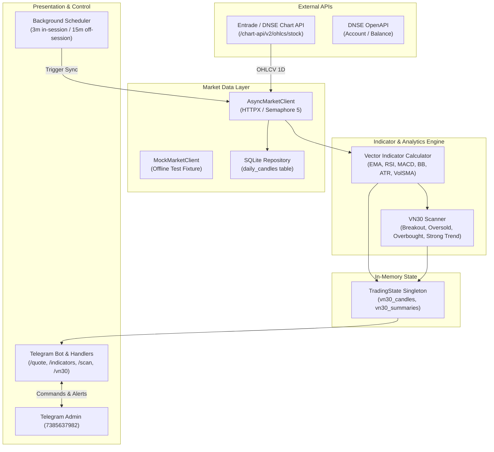

# Technical Specification: Phase 2 — Market Data Feed & Indicator Engine (VN30 / 1D)

- **Author**: Antigravity & User Pair Programming
- **Date**: 2026-09-23
- **Status**: Draft for User Review
- **Subsystem**: Market Data Ingestion, Technical Analysis Engine & Telegram Query Interface
- **Target Platform**: Windows 11 / Python 3.12+ / Entrade (DNSE) Chart API

---

## 1. Executive Summary & Goals

Phase 2 builds the **Market Data Feed & Technical Indicator Engine** for the AI Auto Trading Bot. While Phase 1 established account portfolio tracking and live connectivity to DNSE OpenAPI, Phase 2 enables market perception:
1. **Direct High-Speed Market Ingestion**: Streamlined fetching of historical and intraday Daily (`1D`) OHLCV candles for all 30 tickers in the VN30 basket via Entrade/DNSE Chart API.
2. **Robust Local SQLite Candle Store**: Persistent storage of daily candles with upsert capabilities, enabling offline cold starts and reducing redundant API requests.
3. **Pure Vector Indicator Engine**: Vectorized technical calculations (`numpy`) for Trend (EMA 9, 21, 50, 200), Momentum (RSI 14, MACD 12/26/9), Volatility (Bollinger Bands 20/2, ATR 14), and Volume (Vol SMA 20, Vol Ratio) without external C-compilation dependencies like TA-Lib.
4. **Instant In-Memory RAM Cache**: Pre-computed technical summaries for all 30 VN30 stocks held in RAM (`TradingState`), enabling sub-5ms Telegram command response times.
5. **Interactive Telegram Market Intelligence**: Commands `/quote <SYMBOL>`, `/indicators <SYMBOL>`, `/scan`, `/vn30` and quick inline keyboard buttons for on-the-go analysis.
6. **Strict Safety Protocol**: 100% Read-Only / Analytical mode. Zero order placement risk.

---

## 2. VN30 Basket Definition

The VN30 universe is configured in [config/constants.py](file:///d:/TradingBot/config/constants.py):
```python
VN30_SYMBOLS = [
    "ACB", "BID", "BSR", "BVH", "CTG", "FPT", "GAS", "GVR", "HDB", "HPG",
    "MBB", "MCH", "MSN", "MWG", "POW", "SAB", "SSB", "SSI", "STB", "TCB",
    "TCX", "VCB", "VHM", "VIB", "VIC", "VJC", "VNM", "VPB", "VPL", "VRE"
]
```

---

## 3. Architecture & Data Flow



---

## 4. Component Specifications

### 4.1. Data Models (`market/models.py`)
- `Candle`:
  - `timestamp: int` (epoch seconds)
  - `date_str: str` (YYYY-MM-DD)
  - `open: float`
  - `high: float`
  - `low: float`
  - `close: float`
  - `volume: int`
- `OHLCVSeries`:
  - `symbol: str`
  - `resolution: str = "1D"`
  - `candles: list[Candle]`
  - Properties returning numpy arrays: `closes_np`, `highs_np`, `lows_np`, `opens_np`, `volumes_np`.
- `SymbolQuote`:
  - `symbol: str`
  - `last_price: float`
  - `change: float`
  - `change_pct: float`
  - `open: float`, `high: float`, `low: float`
  - `volume: int`
  - `vol_sma20: float`
  - `vol_ratio: float`

### 4.2. Market Client (`market/client.py` & `market/mock_client.py`)
- **Base URL**: `https://services.entrade.com.vn/chart-api/v2`
- **Endpoint**: `/ohlcs/stock?from={start}&to={end}&symbol={symbol}&resolution=1D`
- **Methods**:
  - `async get_candles(symbol: str, count: int = 150) -> OHLCVSeries`:
    Queries from `now - (count * 1.5 * 86400)` to `now`, parses response keys `["t", "o", "h", "l", "c", "v"]`.
  - `async get_all_vn30_candles(symbols: list[str]) -> dict[str, OHLCVSeries]`:
    Executes parallel requests bounded by `asyncio.Semaphore(5)` with automatic retry.
- **Mock Client**: Generates 150 deterministic candles for 30 symbols, allowing full offline testing without API access.

### 4.3. SQLite Candle Storage (`storage/db.py` & `storage/repository.py`)
- Schema:
  ```sql
  CREATE TABLE IF NOT EXISTS daily_candles (
      symbol TEXT NOT NULL,
      timestamp INTEGER NOT NULL,
      date_str TEXT NOT NULL,
      open REAL NOT NULL,
      high REAL NOT NULL,
      low REAL NOT NULL,
      close REAL NOT NULL,
      volume INTEGER NOT NULL,
      created_at REAL NOT NULL,
      PRIMARY KEY (symbol, timestamp)
  );
  CREATE INDEX IF NOT EXISTS idx_candles_symbol_time ON daily_candles(symbol, timestamp DESC);
  ```
- Operations:
  - `save_candles(symbol: str, series: OHLCVSeries)`: Batch upsert (`INSERT OR REPLACE INTO daily_candles`).
  - `get_candles(symbol: str, limit: int = 150) -> OHLCVSeries`: Fetches latest stored candles sorted ascending by timestamp.
  - `get_latest_candle(symbol: str) -> Optional[Candle]`.

### 4.4. Indicator Engine (`indicators/calculator.py` & `indicators/models.py`)
Vector calculations using `numpy`:
1. **Exponential Moving Average (EMA)**:
   - \(\alpha = \frac{2}{N + 1}\)
   - Periods: EMA9, EMA21, EMA50, EMA200.
2. **Relative Strength Index (RSI 14)**:
   - Wilder's smoothing algorithm on positive gains and negative losses.
   - Range: 0 to 100.
3. **MACD (12, 26, 9)**:
   - \(\text{MACD Line} = \text{EMA}_{12} - \text{EMA}_{26}\)
   - \(\text{Signal Line} = \text{EMA}_9(\text{MACD Line})\)
   - \(\text{Histogram} = \text{MACD Line} - \text{Signal Line}\)
4. **Bollinger Bands (20, 2)**:
   - Middle = SMA20
   - Upper = Middle + 2 * \(\sigma_{20}\)
   - Lower = Middle - 2 * \(\sigma_{20}\)
5. **Average True Range (ATR 14)**:
   - \(\text{TR} = \max(H - L, |H - C_{t-1}|, |L - C_{t-1}|)\)
   - \(\text{ATR}_{14} = \text{EMA}_{14}(\text{TR})\)
6. **Volume SMA 20 & Ratio**:
   - \(\text{Vol SMA}_{20} = \text{mean}(V_{-20:})\)
   - \(\text{Vol Ratio} = \frac{V_{\text{current}}}{\text{Vol SMA}_{20}}\)

**Model `TechnicalSummary`**:
Summarizes calculated values, trend assessment (`UPTREND`, `DOWNTREND`, `SIDEWAYS`), RSI status (`OVERSOLD`, `OVERBOUGHT`, `NEUTRAL`), MACD status (`BULLISH_CROSS`, `BEARISH_CROSS`, etc.), and composite label (`MUA MẠNH`, `THEO DÕI MUA`, `TRUNG LẬP`, `CẢNH BÁO / BÁN`).

### 4.5. Signal Scanner (`indicators/scanner.py`)
- Groups VN30 stocks into 4 strategic categories:
  - 🚀 **Bùng nổ Khối lượng & Xu hướng (Momentum Breakout)**: `Close > EMA21` and `Vol Ratio >= 1.3` and `MACD Hist > 0`.
  - 💎 **Vùng Quá Bán / Tích lũy (Oversold)**: `RSI < 35` or `Close <= BB Lower * 1.01`.
  - ⚠️ **Vùng Quá Mua (Overbought)**: `RSI > 70` or `Close >= BB Upper`.
  - ⭐ **Xu hướng Tăng Vững chắc (Strong Trend)**: `Close > EMA9 > EMA21 > EMA50`.

### 4.6. Scheduler & Smart Alerts (`core/scheduler.py`)
- Background job `sync_market_data_job`:
  - Frequency: 3 minutes during trading hours (09:00 - 15:00 Mon-Fri), 15 minutes off-hours.
  - Updates VN30 daily candles and recalculates indicators in RAM and SQLite.
  - Real-time Alerting: If any VN30 stock demonstrates `Vol Ratio >= 2.0` and `Change % >= +2.5%` during continuous trading session, triggers immediate alert to Telegram Admin.

### 4.7. Telegram Bot Commands (`bot/handlers/market.py`)
1. `/quote <SYMBOL>` (or `/q <SYMBOL>`): Real-time daily snapshot, price, volume, change, and 52-week context.
2. `/indicators <SYMBOL>` (or `/i <SYMBOL>`): Detailed technical report with formatted metrics and composite signal.
3. `/scan` (Button `🔍 Quét VN30`): Filtered list of VN30 stocks matching breakout, oversold, or overbought criteria.
4. `/vn30` (Button `📈 Bảng giá VN30`): Top 5 gainers and top 5 losers in the VN30 basket.

---

## 5. Error Handling & Resilience
- **Network Outage**: If Entrade Chart API is unreachable, bot logs warning, falls back to local SQLite candles, and flags connection status.
- **Malformed Data**: Pydantic schema validation rejects incomplete candle records without crashing the worker.
- **Rate Limit Defense**: `asyncio.Semaphore(5)` and 200ms pause between batches prevents IP throttling.
- **Zero Trading Risk**: Read-only operations only. No order placement methods exist in market or indicator modules.

---

## 6. Verification & Testing Strategy
1. `tests/test_market_models.py`: Validate candle models, OHLCV series, and numpy conversions.
2. `tests/test_market_client.py`: Test both `MockMarketClient` and live Entrade endpoint with real VN30 tickers.
3. `tests/test_calculator.py`: Unit tests for mathematical accuracy of EMA, RSI, MACD, Bollinger Bands, ATR, and VolSMA against known test vectors.
4. `tests/test_scanner.py`: Verify filtering criteria and correct classification of synthetic candle data.
5. `tests/test_market_storage.py`: Test SQLite candle insertion, deduplication, and retrieval.
6. `tests/test_market_handlers.py`: Test Telegram command handlers (`/quote`, `/indicators`, `/scan`, `/vn30`) with mocked bot messages.
