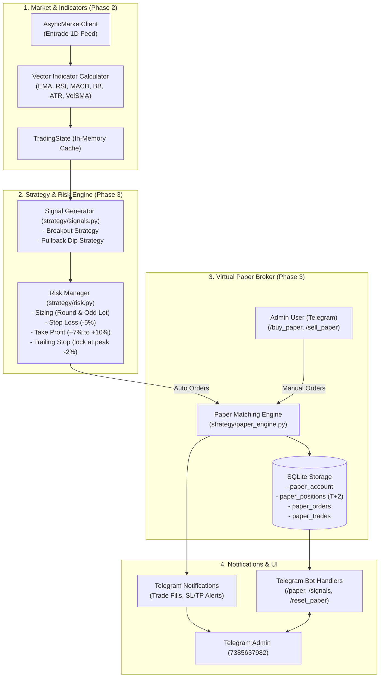

# Technical Specification: Phase 3 — Trading Strategy Engine & Paper Trading Simulation

- **Author**: Antigravity & User Pair Programming
- **Date**: 2026-09-23
- **Status**: Draft for User Review
- **Subsystem**: Strategy Signal Generator, Risk Manager, Virtual Broker (Paper Engine) & Telegram Interface
- **Target Platform**: Windows 11 / Python 3.12+ / Entrade Chart API & SQLite / Telegram Bot

---

## 1. Executive Summary & Goals

Phase 3 introduces the **Automated Strategy & Paper Trading Simulation Engine** to the AI Auto Trading Bot. While Phase 1 provided read-only portfolio tracking and Phase 2 delivered market data ingestion and technical indicators, Phase 3 closes the loop by generating high-probability trading signals and executing simulated trades in real-time without risking real capital:

1. **Virtual Capital Foundation**: Initial simulated cash balance of **5,000,000 VNĐ** stored in SQLite.
2. **Flexible Lot Support**: Full support for both **Standard Round Lots** (lô chẵn, multiples of 100) and **Odd Lots** (lô lẻ, 1 to 99 shares), allowing complete flexibility to trade high-priced VN30 tickers (e.g., FPT, VCB, VJC) with limited capital.
3. **Dual Strategy Signal Generator**:
   - **Strategy A (Trend Following Momentum Breakout)**: Enters high-momentum breakouts when Price > EMA21 > EMA50, MACD Bullish Cross occurs, and Volume >= 1.3x VolSMA20.
   - **Strategy B (Pullback / Buy on Dip)**: Enters healthy pullbacks in confirmed uptrends when price touches EMA21 or Lower Bollinger Band with RSI cooling down to 30–45 and reversal candlestick confirmation.
4. **Realistic Paper Matching Engine**:
   - Real-world fee and tax structure: **0.15% buy fee**, **0.25% sell fee & tax** (0.15% brokerage + 0.1% tax).
   - Market Orders (MP) matching at real-time market prices, Limit Orders (LO) matching on price trigger.
   - **Default T+2 Settlement Cycle**: Shares bought at Day $T$ settle and become available to sell at Day $T+2$ (simulating HOSE clearing rules).
5. **Always-On Autonomous Auto-Trade**: Auto-trade is **enabled by default** (`auto_trade_enabled = True`). Bot automatically sizes and executes trades whenever available cash $\ge$ required purchase cost (down to 0 VNĐ remaining cash).
6. **Active Risk Management**:
   - Automatic Hard Stop-Loss at $-5\%$.
   - Automatic Take-Profit at $+7\%$ to $+10\%$, or RSI > 75 with bearish reversal.
   - Dynamic Trailing Stop activated once profit reaches $+5\%$, locking profits if price drops $2\%$ from peak.
7. **Interactive Telegram Management**: Commands `/paper`, `/signals`, `/buy_paper`, `/sell_paper`, `/autotrade_paper`, `/reset_paper`, plus updated inline menu buttons.
8. **Absolute Capital Safety**: 100% simulated paper trading on local SQLite tables. Zero live order APIs are invoked to DNSE OpenAPI.

---

## 2. Architecture & Data Flow



---

## 3. Detailed Component Specifications

### 3.1. Data Models (`strategy/models.py`)

- **`SignalType` (Enum)**: `BUY`, `SELL`, `HOLD`.
- **`StrategyName` (Enum)**: `BREAKOUT` (Trend Following Breakout), `PULLBACK` (Buy on Dip), `MANUAL` (User initiated).
- **`Signal` (Pydantic Model)**:
  - `symbol: str`: VN30 ticker.
  - `signal_type: SignalType`: BUY or SELL.
  - `strategy: StrategyName`: Breakout or Pullback.
  - `price: float`: Suggested entry/exit price.
  - `confidence: float`: Score from 0.0 to 1.0.
  - `reason: str`: Human-readable rationale (Vietnamese with diacritics).
  - `timestamp: datetime`: Time of generation.
- **`OrderSide` (Enum)**: `BUY`, `SELL`.
- **`OrderStatus` (Enum)**: `PENDING`, `FILLED`, `CANCELLED`, `REJECTED`.
- **`OrderType` (Enum)**: `MP` (Market Price), `LO` (Limit Order).
- **`PaperOrder` (Pydantic Model)**:
  - `order_id: str`: Unique ID (`ORD-<timestamp>-<uuid4[:6]>`).
  - `symbol: str`
  - `side: OrderSide`
  - `quantity: int`: Positive integer $\ge 1$ (supports both round lots e.g. 100, 200 and odd lots e.g. 15, 35).
  - `price: float`
  - `order_type: OrderType`
  - `status: OrderStatus`
  - `fee: float`: Transaction fee.
  - `tax: float`: Tax on sell orders.
  - `created_at: datetime`
  - `matched_at: Optional[datetime]`
- **`PaperPosition` (Pydantic Model)**:
  - `symbol: str`
  - `total_quantity: int`: Total shares owned (both settled and unsettled).
  - `available_quantity: int`: Shares that have settled (Day $T+2$) and are eligible for selling.
  - `pending_settlement: list[dict]`: List of pending tranches with `{quantity: int, buy_date: str, settle_date: str}`.
  - `avg_buy_price: float`: Weighted average purchase price.
  - `current_price: float`: Latest market price.
  - `highest_price: float`: Highest price recorded since open (for Trailing Stop).
  - `unrealized_pnl: float`: Unrealized profit/loss in VNĐ.
  - `unrealized_pnl_pct: float`: Unrealized profit/loss percentage.
- **`PaperAccount` (Pydantic Model)**:
  - `initial_balance: float = 5_000_000.0`
  - `cash_balance: float`: Liquid cash available.
  - `stock_value: float`: Total market value of all held positions.
  - `nav: float`: Net Asset Value (`cash_balance + stock_value`).
  - `total_realized_pnl: float`: Accumulated realized PnL.
  - `auto_trade_enabled: bool = True`: Always enabled by default.

---

### 3.2. Strategy Signal Rules (`strategy/signals.py`)

#### Strategy A: Trend Following Momentum Breakout (`BREAKOUT`)
- **Trend Filter**:
  $$\text{Close} > \text{EMA}_{21} > \text{EMA}_{50}$$
- **Momentum Filter**:
  - $\text{MACD Line} > \text{Signal Line}$ (Bullish crossover within the last 3 bars).
  - $\text{MACD Histogram} > 0$.
- **Volume Surge**:
  $$\text{Volume} \ge 1.3 \times \text{VolSMA}_{20}$$
- **Candle Pattern**: Bullish closing candle ($\text{Close} > \text{Open}$ and $\text{Close} > \text{Close}_{t-1}$).
- **Signal**: Generate `Signal(type=BUY, strategy=BREAKOUT)`.

#### Strategy B: Pullback / Buy on Dip (`PULLBACK`)
- **Macro Trend Filter**:
  $$\text{Close} > \text{EMA}_{50} \quad \text{or} \quad \text{Close} > \text{EMA}_{200}$$
- **Pullback Condition**:
  - Price retraces close to $\text{EMA}_{21}$ ($\text{Low} \le \text{EMA}_{21} \times 1.01$ and $\text{Close} \ge \text{EMA}_{21} \times 0.985$) OR touches Lower Bollinger Band ($\text{Low} \le \text{Lower BB} \times 1.01$).
- **Oversold Cool-down**:
  $$30 \le \text{RSI}_{14} \le 45$$
  (Indicator has cooled down significantly without falling into deep panic collapse $< 25$).
- **Reversal Confirmation**:
  - Hammer / Pin-bar candle or Bullish Reversal ($\text{Close} > \text{Low}_{t-1}$ and $\text{Close} > \text{Open}$).
- **Signal**: Generate `Signal(type=BUY, strategy=PULLBACK)`.

---

### 3.3. Risk Management & Sizing (`strategy/risk.py`)

#### 1. Position Sizing with Round & Odd Lots
- **Maximum Concurrent Positions**: 2 to 3 stocks.
- **Available Cash Threshold**: Trade executes whenever available cash is sufficient to purchase at least **1 share** plus fee ($0.15\%$). No arbitrary 1.5M VND restriction.
- **Dynamic Lot Sizing Formula**:
  1. Determine target allocation: $V_{\text{target}} = \min(\text{Available Cash}, \text{NAV} / 2)$.
  2. Compute raw shares: $Q_{\text{raw}} = \lfloor V_{\text{target}} / (\text{Price} \times 1.0015) \rfloor$.
  3. If $Q_{\text{raw}} \ge 100$: Round down to nearest 100 (Round lot: $Q = \lfloor Q_{\text{raw}} / 100 \rfloor \times 100$).
  4. If $1 \le Q_{\text{raw}} < 100$: Use odd lot ($Q = Q_{\text{raw}}$).
  5. If $Q < 1$: Reject order due to insufficient funds.

#### 2. Exit Rules (Stop-Loss, Take-Profit & Trailing Stop)
- **Hard Stop-Loss (SL)**: Auto-sell when current price $\le \text{avg\_buy\_price} \times 0.95$ ($-5.0\%$).
- **Take-Profit Target (TP)**: Auto-sell when current price $\ge \text{avg\_buy\_price} \times 1.08$ ($+8.0\%$ baseline, or $+7\%$ if $\text{RSI}_{14} > 75$).
- **Dynamic Trailing Stop**:
  - Activated when $\text{current\_price} \ge \text{avg\_buy\_price} \times 1.05$ ($+5.0\%$ gain).
  - Maintains `highest_price = max(highest_price, current_price)`.
  - Exit trigger: Auto-sell if price retreats by $2.0\%$ from the recorded peak:
    $$\text{Price} \le \text{highest\_price} \times 0.98$$
- **Settlement Rule for Exits**:
  - Exits apply to `available_quantity` (settled shares under T+2 rule). If a position is still pending settlement, an urgent alert is sent to Telegram notifying that the position hit SL/TP but is waiting for T+2 clearing.

---

### 3.4. Paper Matching Engine (`strategy/paper_engine.py`)

#### 1. Financial Calculations
- **Buy Order Execution**:
  $$\text{Gross Amount} = \text{Price} \times \text{Quantity}$$
  $$\text{Fee} = \text{Gross Amount} \times 0.0015$$
  $$\text{Total Deducted} = \text{Gross Amount} + \text{Fee}$$
- **Sell Order Execution**:
  $$\text{Gross Amount} = \text{Price} \times \text{Quantity}$$
  $$\text{Fee} = \text{Gross Amount} \times 0.0015$$
  $$\text{Tax} = \text{Gross Amount} \times 0.0010$$
  $$\text{Net Received} = \text{Gross Amount} - \text{Fee} - \text{Tax}$$
  $$\text{Realized PnL} = \text{Net Received} - (\text{avg\_buy\_price} \times \text{Quantity})$$

#### 2. T+2 Settlement Logic
- Each buy execution records a lot tranche with:
  - `quantity`: shares purchased.
  - `buy_date`: trading date $T$ (YYYY-MM-DD).
  - `settle_date`: trading date $T+2$ (skipping weekends).
- On each scheduler cycle, the engine checks current date against `settle_date`. Tranches reaching $T+2$ are transferred from pending status to `available_quantity`.

---

### 3.5. Database Schema Additions (`storage/db.py`)

```sql
-- Paper Trading Virtual Account
CREATE TABLE IF NOT EXISTS paper_account (
    id INTEGER PRIMARY KEY CHECK (id = 1),
    initial_balance REAL NOT NULL DEFAULT 5000000.0,
    cash_balance REAL NOT NULL DEFAULT 5000000.0,
    auto_trade_enabled INTEGER NOT NULL DEFAULT 1,
    created_at TIMESTAMP DEFAULT CURRENT_TIMESTAMP,
    updated_at TIMESTAMP DEFAULT CURRENT_TIMESTAMP
);

-- Paper Positions (with T+2 support)
CREATE TABLE IF NOT EXISTS paper_positions (
    id INTEGER PRIMARY KEY AUTOINCREMENT,
    symbol TEXT NOT NULL UNIQUE,
    total_quantity INTEGER NOT NULL DEFAULT 0,
    available_quantity INTEGER NOT NULL DEFAULT 0,
    avg_buy_price REAL NOT NULL DEFAULT 0.0,
    highest_price REAL NOT NULL DEFAULT 0.0,
    updated_at TIMESTAMP DEFAULT CURRENT_TIMESTAMP
);

-- Pending Settlement Tranches (T+2)
CREATE TABLE IF NOT EXISTS paper_settlement_tranches (
    id INTEGER PRIMARY KEY AUTOINCREMENT,
    symbol TEXT NOT NULL,
    quantity INTEGER NOT NULL,
    buy_date TEXT NOT NULL,
    settle_date TEXT NOT NULL,
    is_settled INTEGER NOT NULL DEFAULT 0,
    created_at TIMESTAMP DEFAULT CURRENT_TIMESTAMP
);

-- Paper Orders Ledger
CREATE TABLE IF NOT EXISTS paper_orders (
    id INTEGER PRIMARY KEY AUTOINCREMENT,
    order_id TEXT NOT NULL UNIQUE,
    symbol TEXT NOT NULL,
    side TEXT NOT NULL,
    quantity INTEGER NOT NULL,
    order_type TEXT NOT NULL DEFAULT 'MP',
    price REAL NOT NULL,
    status TEXT NOT NULL DEFAULT 'FILLED',
    fee REAL NOT NULL DEFAULT 0.0,
    tax REAL NOT NULL DEFAULT 0.0,
    created_at TIMESTAMP DEFAULT CURRENT_TIMESTAMP
);

-- Paper Trades History (Realized PnL)
CREATE TABLE IF NOT EXISTS paper_trades (
    id INTEGER PRIMARY KEY AUTOINCREMENT,
    order_id TEXT NOT NULL,
    symbol TEXT NOT NULL,
    side TEXT NOT NULL,
    quantity INTEGER NOT NULL,
    price REAL NOT NULL,
    fee REAL NOT NULL,
    tax REAL NOT NULL,
    realized_pnl REAL NOT NULL DEFAULT 0.0,
    executed_at TIMESTAMP DEFAULT CURRENT_TIMESTAMP
);
```

---

### 3.6. Telegram Commands & Bot Interface

- `/paper`:
  - Displays: Total NAV, Initial Capital (5,000,000đ), Available Cash, Realized PnL, Unrealized PnL.
  - Position Breakdown: Symbol, Total Qty, Available Qty (T+2), Avg Price, Market Price, PnL %, PnL VND.
- `/signals`:
  - Scans VN30 tickers in RAM cache.
  - Lists tickers meeting Breakout criteria or Pullback criteria with specific price and rationale.
- `/buy_paper <SYMBOL> <QUANTITY> [PRICE]`:
  - Manually places a paper buy order.
  - Supports odd lots ($1 \le Q \le 99$) and round lots ($Q \ge 100$).
  - If `PRICE` is omitted, matches immediately at market `last_price`.
- `/sell_paper <SYMBOL> <QUANTITY> [PRICE]`:
  - Manually places a paper sell order against `available_quantity` (T+2 settled).
- `/autotrade_paper [on|off]`:
  - Checks or toggles the state of auto-trade (Defaults to **ON**).
- `/reset_paper`:
  - Prompts confirmation inline button `[ Xác nhận Reset 5M VNĐ ]`.
  - Resets cash balance to 5,000,000 VNĐ, clears open positions and tranches.

---

## 4. Verification & Testing Strategy

1. **Unit Tests**:
   - `tests/test_strategy_signals.py`: Test Breakout and Pullback mathematical conditions with synthetic candle series.
   - `tests/test_risk_management.py`: Test round lot / odd lot sizing with 5M budget, Stop Loss (-5%), Take Profit (+8%), Trailing Stop (-2% from peak).
   - `tests/test_paper_engine.py`: Test buy/sell balance updates, fee (0.15%) and tax (0.10%) deductions, and T+2 settlement transitions.
2. **Integration Tests**:
   - `tests/test_paper_bot_handlers.py`: Test `/paper`, `/signals`, `/buy_paper`, `/sell_paper`, `/autotrade_paper`, `/reset_paper` commands.
   - `tests/test_paper_e2e.py`: Simulate a full cycle: Signal generation $\to$ Auto-trade buy $\to$ Price update $\to$ Trailing stop trigger $\to$ Auto-trade sell.
3. **Safety Verification**:
   - Verify that DNSE OpenAPI order placement functions are NEVER imported or called in the `strategy/` or `paper/` code. All transactions strictly target SQLite.

---

## 5. Non-Functional Requirements & Performance

- **Execution Latency**: Signal evaluation and paper order matching must take $< 10$ milliseconds per VN30 ticker.
- **Data Integrity**: All database updates performed inside SQLite transactions (`BEGIN IMMEDIATE` / `COMMIT`).
- **Resilience**: Bot restarts preserve virtual cash, active positions, and T+2 pending settlement schedules seamlessly.
