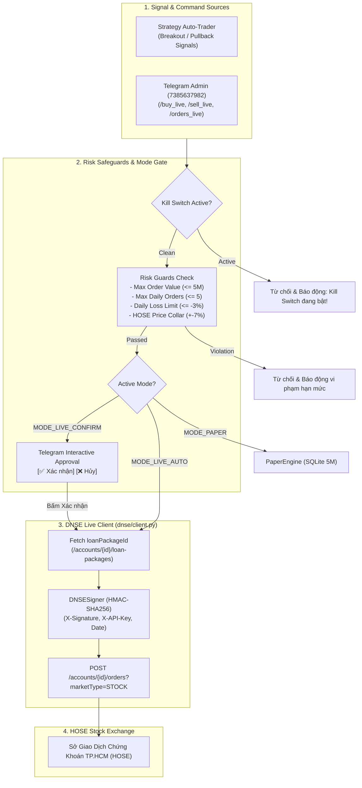

# Technical Specification: Phase 4 — Live Order Execution & Risk Safeguards

- **Author**: Antigravity & User Pair Programming
- **Date**: 2026-09-23
- **Status**: Draft for User Review
- **Subsystem**: Live Order Execution (DNSE LightSpeed API V2), Order State Machine, Risk Safeguards, Kill Switch & Telegram Interface
- **Target Platform**: Windows 11 / Python 3.12+ / DNSE OpenAPI (openapi.dnse.com.vn) / Telegram Bot

---

## 1. Executive Summary & Goals

Phase 4 enables **Live Order Execution (Giao dịch Tiền Thật)** on the Vietnam Stock Market via DNSE LightSpeed API V2 while enforcing bank-grade **Risk Safeguards** and an **Emergency Kill Switch** to ensure capital preservation:

1. **Direct DNSE Order Integration**:
   - Order placement (`POST /accounts/{account_no}/orders?marketType=STOCK&orderCategory=NORMAL`).
   - Order book query (`GET /accounts/{account_no}/orders?marketType=STOCK`).
   - Order cancellation (`DELETE /accounts/{account_no}/orders/{order_id}?marketType=STOCK`).
   - Automated dynamic resolution of `loanPackageId` via `GET /accounts/{account_no}/loan-packages`.
2. **Flexible Authentication Design**:
   - Fully utilizes `DNSE_API_KEY` and `DNSE_API_SECRET` for HMAC-SHA256 request signing (`X-Signature`, `X-API-Key`, `Date`).
   - Supports optional `trading-token` header if provided, but does not block order submission. Captures and handles any API status codes gracefully.
3. **Three-Tier Trading Modes**:
   - `MODE_PAPER` (Default): Safely simulates virtual trades on the 5M VND SQLite account. Zero live API order calls.
   - `MODE_LIVE_CONFIRM` (Semi-Automated): Strategy signals generate interactive Telegram approval dialogues `[✅ Xác nhận Đặt Lệnh Thật] [❌ Hủy Bỏ]`.
   - `MODE_LIVE_AUTO` (Full Autonomous Live): Places orders directly onto DNSE when signals and risk checks align.
4. **Multi-Layered Capital Safeguards**:
   - **Emergency Kill Switch (`/kill_switch`)**: Cancels all pending orders instantly, cuts off auto-trading, and locks system to `READ_ONLY`.
   - **Maximum Order Value Guard**: Default capped at `5,000,000 VNĐ` per order (configurable in `.env`).
   - **Maximum Daily Orders Guard**: Capped at `5 orders/day` to eliminate looping or high-frequency errors.
   - **Maximum Daily Loss Guard**: Auto-kills live trading if realized daily loss exceeds `-3.0%`.
   - **Price Collar Guard**: Enforces HOSE daily price limits ($\pm 7.0\%$).
   - **Lot Rules**: Enforces HOSE round lots ($\ge 100$) and odd lots ($1-99$).
5. **Real-Time Telegram Control**:
   - Commands `/mode`, `/buy_live`, `/sell_live`, `/orders_live`, `/cancel_live`, `/kill_switch`, `/resume`.
   - Instant Telegram notification upon order submission, fill confirmation, or rejection.

---

## 2. Architecture & Data Flow



---

## 3. Component Specifications

### 3.1. DNSE Client Live Order Methods (`dnse/client.py`)

- **`get_loan_packages(account_no: str, symbol: str) -> list[dict]`**:
  - `path = f"/accounts/{account_no}/loan-packages"`
  - `query = f"{path}?symbol={symbol.upper()}&marketType=STOCK"`
  - Signs with HMAC `DNSESigner.build_headers("GET", path)`.
  - Returns list of packages (e.g. `[{"id": 1258, "name": "ZaloPay", ...}]`).
- **`place_order(...) -> dict`**:
  - Arguments:
    - `account_no: str`
    - `symbol: str`
    - `side: str` (`"NB"` for Buy, `"NS"` for Sell)
    - `order_type: str` (`"LO"` or `"MP"`)
    - `quantity: int`
    - `price: float`
    - `loan_package_id: Optional[int] = None` (auto-queried if omitted)
    - `trading_token: Optional[str] = None`
  - URL: `f"/accounts/{account_no}/orders?marketType=STOCK&orderCategory=NORMAL"`
  - Headers: `X-API-Key`, `X-Signature`, `Date`, optional `trading-token`.
  - Body:
    ```json
    {
      "symbol": "HPG",
      "side": "NB",
      "orderType": "LO",
      "quantity": 100,
      "price": 26000.0,
      "loanPackageId": 1258
    }
    ```
- **`get_orders(account_no: str) -> list[dict]`**:
  - URL: `f"/accounts/{account_no}/orders?marketType=STOCK"`
  - Returns current day orders.
- **`cancel_order(account_no: str, order_id: str) -> dict`**:
  - URL: `f"/accounts/{account_no}/orders/{order_id}?marketType=STOCK"`
  - Method: `DELETE`.

---

### 3.2. Risk Safeguards Manager (`core/risk_safeguards.py`)

- **`TradingMode` (Enum)**: `PAPER`, `LIVE_CONFIRM`, `LIVE_AUTO`.
- **`RiskSafeguards` (Class)**:
  - Attributes:
    - `mode: TradingMode = TradingMode.PAPER`
    - `kill_switch_active: bool = False`
    - `max_order_value: float = 5_000_000.0`
    - `max_daily_orders: int = 5`
    - `max_daily_loss_pct: float = -0.03`
    - `daily_orders_count: int = 0`
    - `daily_realized_loss: float = 0.0`
  - Methods:
    - `validate_order(symbol: str, side: str, quantity: int, price: float, reference_price: Optional[float] = None) -> tuple[bool, str]`:
      1. Checks if `kill_switch_active` is True -> rejects.
      2. Checks if `daily_orders_count >= max_daily_orders` -> rejects.
      3. Checks order gross value `price * quantity > max_order_value` -> rejects.
      4. Checks price collar: if `reference_price` provided, price must be within $[0.93 \times P_{\text{ref}}, 1.07 \times P_{\text{ref}}]$.
      5. Returns `(True, "OK")` if all checks pass.
    - `activate_kill_switch(reason: str)`: Sets `kill_switch_active = True`.
    - `deactivate_kill_switch()`: Sets `kill_switch_active = False`.
    - `record_order_sent()`: Increments `daily_orders_count`.
    - `reset_daily_counters()`: Resets counters at 00:00 every trading day.

---

### 3.3. Live Order Execution Service (`strategy/live_trader.py`)

- Connects `AutoTrader`, `TradingState`, `DNSEClient`, `RiskSafeguards`, and `TelegramNotifier`.
- Handles dispatching:
  - If `mode == PAPER`: Delegates to `PaperEngine`.
  - If `mode == LIVE_CONFIRM`: Formats Telegram approval message with inline buttons `cb_confirm_live_order:<order_hash>` and `cb_cancel_live_order:<order_hash>`.
  - If `mode == LIVE_AUTO`: Calls `dnse_client.place_order` immediately after passing safeguards.

---

### 3.4. Telegram Commands (`bot/handlers/live.py`)

- `/mode [paper | live_confirm | live_auto]`:
  - Switching to `live_auto` prompts an explicit warning: `⚠️ BẠN ĐANG BẬT GIAO DỊCH TIỀN THẬT TỰ ĐỘNG!`.
- `/buy_live <SYMBOL> <QUANTITY> [PRICE]`:
  - Places manual live buy order through risk safeguards.
- `/sell_live <SYMBOL> <QUANTITY> [PRICE]`:
  - Places manual live sell order through risk safeguards.
- `/orders_live`:
  - Fetches and displays current day orders from DNSE (orderId, symbol, side, qty, price, status).
- `/cancel_live <ORDER_ID>`:
  - Sends cancellation request to DNSE.
- `/kill_switch`:
  - Cancels all pending orders on DNSE, sets `kill_switch_active = True`, alerts admin.
- `/resume`:
  - Unlocks kill switch and returns bot to active duty.

---

## 4. Verification & Testing Strategy

1. **Unit Tests**:
   - `tests/test_dnse_live_orders.py`: Mock and live tests for `place_order`, `get_orders`, `cancel_order`, and `get_loan_packages`.
   - `tests/test_risk_safeguards.py`: Test `MAX_ORDER_VALUE`, `MAX_DAILY_ORDERS`, `MAX_DAILY_LOSS`, and `kill_switch`.
2. **Integration Tests**:
   - `tests/test_live_trader.py`: Test dispatching between Paper, Live Confirm, and Live Auto.
   - `tests/test_live_bot_handlers.py`: Test `/mode`, `/buy_live`, `/orders_live`, `/cancel_live`, `/kill_switch`, `/resume`.
3. **Safety Verification**:
   - Verify that whenever `kill_switch_active` is True or mode is `PAPER`, no HTTP POST/DELETE requests are made to DNSE order endpoints.
